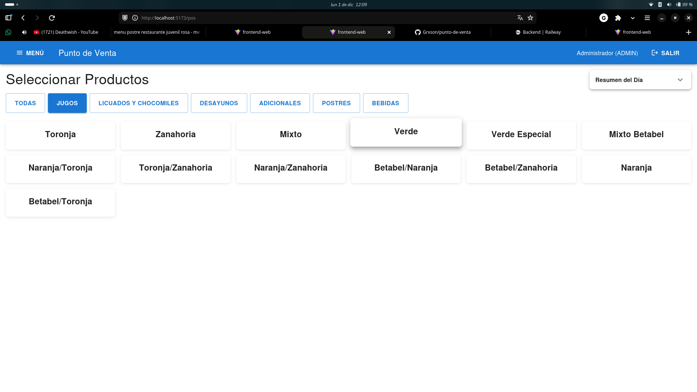

# 📋 PENDIENTES - Módulo de Ventas

## ⏸️ Funcionalidades Pendientes de Implementar

### 1. **Cálculo de IVA/Impuestos**
**Estado:** ⏸️ PENDIENTE  
**Prioridad:** MEDIA  
**Descripción:**
- Actualmente el campo `impuestos` en la tabla `ventas` está en cero por defecto
- Se debe implementar el cálculo automático de IVA según las reglas fiscales
- Considerar:
  - Tasa de IVA configurable (16% estándar en México)
  - Productos exentos de IVA
  - Desglose de impuestos en el ticket

**Archivos afectados:**
- `backend/src/main/java/com/puntodeventa/backend/model/Venta.java` (línea 51)
- `backend/src/main/java/com/puntodeventa/backend/service/VentaService.java` (lógica de cálculo)

**Ejemplo de implementación:**
```java
// En VentaService.crearVenta():
BigDecimal tasaIVA = new BigDecimal("0.16"); // 16%
BigDecimal impuestos = subtotal.multiply(tasaIVA);
venta.setImpuestos(impuestos);
venta.setTotal(subtotal.add(impuestos).subtract(descuento));
```

---

### 2. **Sistema de Descuentos**
**Estado:** ⏸️ PENDIENTE  
**Prioridad:** MEDIA  
**Descripción:**
- Actualmente el campo `descuento` está en cero
- Implementar sistema de descuentos estructurado:
  - Descuentos por porcentaje o monto fijo
  - Descuentos por rol de usuario (Admin, Supervisor, Cajero)
  - Descuentos por promociones o cupones
  - Auditoría de descuentos aplicados

**Modelo de datos sugerido:**
```sql
CREATE TABLE descuentos (
    id BIGINT PRIMARY KEY,
    nombre VARCHAR(200) NOT NULL,
    tipo VARCHAR(20) NOT NULL, -- 'PORCENTAJE' o 'MONTO'
    valor DECIMAL(12,2) NOT NULL,
    activo BOOLEAN DEFAULT TRUE,
    max_por_rol_json TEXT, -- {'ADMIN': 100, 'SUPERVISOR': 50, 'CAJERO': 20}
    fecha_inicio DATE,
    fecha_fin DATE
);
```

**Archivos afectados:**
- `backend/src/main/java/com/puntodeventa/backend/model/Venta.java` (línea 55)
- Crear nueva entidad `Descuento`
- Agregar lógica en `VentaService`

---

### 3. **Validación de Stock Suficiente**
**Estado:** ⏸️ PENDIENTE  
**Prioridad:** ALTA  
**Descripción:**
- Validar que haya stock suficiente de ingredientes antes de confirmar una venta
- Evitar ventas que dejen el inventario en negativo
- Mostrar alerta cuando un ingrediente esté por debajo del stock mínimo

**Implementación sugerida:**
```java
// En VentaService.crearVenta(), antes de crear items:
for (VentaItemDTO itemDTO : request.items()) {
    Producto producto = productoRepository.findById(itemDTO.productoId())...;
    
    // Validar stock por receta
    List<Receta> recetas = recetaRepository.findByProductoId(producto.getId());
    for (Receta receta : recetas) {
        BigDecimal cantidadNecesaria = receta.getCantidad()
            .multiply(BigDecimal.valueOf(itemDTO.cantidad()));
        BigDecimal stockDisponible = receta.getIngrediente().getStockActual();
        
        if (stockDisponible.compareTo(cantidadNecesaria) < 0) {
            throw new InsufficientStockException(
                "Stock insuficiente de " + receta.getIngrediente().getNombre()
            );
        }
    }
}
```

**Requisito previo:**
- Agregar campo `stockActual` a la entidad `Ingrediente`

---

### 4. **Campo `stockActual` en Ingrediente**
**Estado:** ⏸️ PENDIENTE  
**Prioridad:** ALTA  
**Descripción:**
- Actualmente la entidad `Ingrediente` no tiene campo para rastrear el stock actual
- Este campo es necesario para:
  - Validar stock antes de ventas
  - Generar alertas de stock mínimo
  - Reportes de inventario

**Cambios necesarios:**
```java
// En Ingrediente.java:
@PositiveOrZero(message = "El stock actual debe ser positivo o cero")
@Column(name = "stock_actual", precision = 12, scale = 3)
private BigDecimal stockActual = BigDecimal.ZERO;
```

**Actualización automática:**
- Sumar en movimientos tipo "INGRESO"
- Restar en movimientos tipo "EGRESO" (ventas)
- Ajustar en movimientos tipo "AJUSTE"

---

### 5. **Cálculo Automático de Costo de Venta**
**Estado:** ✅ IMPLEMENTADO (FASE 1)  
**Prioridad:** MEDIA  
**Descripción:**
- El campo `costoEstimado` en `VentaItem` ahora se llena al crear la venta usando `producto.costoEstimado * cantidad`.
- `producto.costoEstimado` se recalcula desde receta en `ProductoService.recalcularCosto()` considerando merma teórica.
- Faltante para FASE 2: cálculo dinámico del costo del item si el producto cambia antes de guardar, y opción de recalcular costo histórico por cada venta para análisis retroactivo.

**Archivos implementados:**
- `backend/src/main/java/com/puntodeventa/backend/model/VentaItem.java`
- `backend/src/main/java/com/puntodeventa/backend/service/VentaService.java`
- `backend/src/main/java/com/puntodeventa/backend/service/ProductoService.java`

---

### 6. **Cancelación y Edición de Ventas**
**Estado:** ✅ IMPLEMENTADO  
**Prioridad:** MEDIA  
**Descripción:**
- ✅ Endpoint para cancelar ventas implementado
- ✅ Endpoint para editar/actualizar ventas implementado
- ✅ Reversión de movimientos de inventario automática al cancelar o editar
- ✅ Recalculo de movimientos de inventario al editar
- ✅ Auditoría de cancelación y edición (motivo y usuario en nota)
- ✅ Solo permite cancelar/editar ventas de las últimas 24 horas
- ✅ Cualquier empleado autenticado puede cancelar y editar (permisos actualizados)

**Endpoint implementado:**
```java
@PutMapping("/{id}/cancelar")
@PreAuthorize("isAuthenticated()")  // Cualquier empleado autenticado puede cancelar
public ResponseEntity<VentaDTO> cancelarVenta(
    @PathVariable Long id,
    @RequestParam String motivo
) {
    return ResponseEntity.ok(ventaService.cancelarVenta(id, motivo));
}
```

**Endpoints implementados:**
```java
@PutMapping("/{id}")
@PreAuthorize("isAuthenticated()")  // Cualquier empleado autenticado puede editar
public ResponseEntity<VentaDTO> actualizarVenta(
    @PathVariable Long id,
    @Valid @RequestBody ActualizarVentaRequest request
) {
    return ResponseEntity.ok(ventaService.actualizarVenta(id, request));
}

@PutMapping("/{id}/cancelar")
@PreAuthorize("isAuthenticated()")  // Cualquier empleado autenticado puede cancelar
public ResponseEntity<VentaDTO> cancelarVenta(
    @PathVariable Long id,
    @RequestParam String motivo
) {
    return ResponseEntity.ok(ventaService.cancelarVenta(id, motivo));
}
```

**Archivos implementados:**
- `backend/src/main/java/com/puntodeventa/backend/dto/ActualizarVentaRequest.java` - DTO para actualizar ventas
- `backend/src/main/java/com/puntodeventa/backend/service/VentaService.java` - Métodos `cancelarVenta()`, `actualizarVenta()` y `revertirMovimientosInventario()`
- `backend/src/main/java/com/puntodeventa/backend/controller/VentaController.java` - Endpoints `/api/ventas/{id}` y `/api/ventas/{id}/cancelar`
- `backend/src/main/java/com/puntodeventa/backend/repository/InventarioMovimientoRepository.java` - Método `findByRefTipoAndRefId()`
- `frontend-web/src/pages/admin/AdminSales.tsx` - UI para gestionar, editar y cancelar ventas (área admin)
- `frontend-web/src/pages/pos/PosSales.tsx` - UI para que empleados vean, editen y cancelen sus ventas (área POS)

---

### 7. **Reportes de Ventas**
**Estado:** ⏸️ PENDIENTE  
**Prioridad:** BAJA  
**Descripción:**
- Implementar endpoints para reportes avanzados:
  - Ventas por día/semana/mes
  - Productos más vendidos
  - Métodos de pago más usados
  - Margen de ganancia (ventas - costo)
  - Comparativa entre sucursales

---

### 8. **Múltiples Pagos por Venta**
**Estado:** ✅ IMPLEMENTADO  
**Descripción:**
- Ya soportado: una venta puede tener múltiples pagos
- Ejemplo: $200 en efectivo + $150 en tarjeta

---

### 9. **Integración con Cajas y Turnos**
**Estado:** ⏸️ PENDIENTE  
**Prioridad:** BAJA  
**Descripción:**
- Crear entidades `Caja` y `Turno`
- Asociar ventas a cajas y turnos específicos
- Implementar apertura y cierre de caja con arqueo

---

### 10. **Cliente Frecuente / Lealtad**
**Estado:** ⏸️ PENDIENTE  
**Prioridad:** BAJA  
**Descripción:**
- Crear entidad `Cliente`
- Asociar ventas a clientes
- Programa de puntos/recompensas

---

## 📝 Notas de Desarrollo

### Variables de Entorno Sugeridas
```properties
# application.properties
app.ventas.iva.tasa=0.16
app.ventas.descuento.maximo=1000.00
app.ventas.validar-stock=true
```

### Orden de Implementación Recomendado
1. ✅ **Campo `stockActual` en Ingrediente** (requisito para #3)
2. ⏸️ **Validación de stock** (#3)
3. ⏸️ **Cálculo de costo de venta** (#5)
4. ⏸️ **Cálculo de IVA** (#1)
5. ⏸️ **Sistema de descuentos** (#2)
6. ⏸️ **Cancelación de ventas** (#6)
7. ⏸️ **Reportes** (#7)

---

## 🔗 Referencias
- Documentación: `docs/datos/modelo-datos.md`
- Flujo de ventas: `docs/flujo-interno.md`
- Finanzas: `docs/admin/finanzas.md`

---

### 11. **Histórico de Costos de Producto**
**Estado:** ✅ IMPLEMENTADO (CAPTURA AUTOMÁTICA)  
**Prioridad:** MEDIA  
**Descripción:**
- Se creó la entidad `ProductoCostoHistorico` para almacenar cada recalculo de costo.
- Se registra un snapshot cuando cambia el costo estimado tras `recalcularCosto()`.
- Incluye costo, precio, margen absoluto y porcentaje, fuente y fecha.
- Faltante: endpoint para consultar historial por producto y limpieza/retención (archivado).  

**Archivos implementados:**
- `backend/src/main/java/com/puntodeventa/backend/model/ProductoCostoHistorico.java`
- `backend/src/main/java/com/puntodeventa/backend/repository/ProductoCostoHistoricoRepository.java`
- `backend/src/main/java/com/puntodeventa/backend/service/ProductoService.java`

**Próximos pasos sugeridos:**
1. Endpoint `GET /api/productos/{id}/costos/historico` (paginado, orden descendente por fecha)
2. Política de retención (ej: mantener últimos N registros o últimos 18 meses)
3. Indicador de origen adicional (IMPORTACION, AJUSTE_MANUAL)
4. Integrar en estadísticas para mostrar tendencia de margen.


**Pasos de la semana del 29 de noviembre**

- Ver la forma de modificar el precio de un producto en dado caso yo como empleado o dueño tome un producto para consumo propio
- ✅ juntar minihot cakes en un modal por los tamaños 
- ✅ molletes igual juntarlos en un modal con sus variantes
- ✅ hacer posible que podamos modificar precios
- ✅ agregar variantes de jugo de betabel (Betabel/Naranja, Betabel/Zanahoria)
- ✅ agregar productos de jugos mixtos (Naranja/Toronja, Naranja/Zanahoria, Zanahoria/Toronja)
- ✅ el botón para cerrar el carrito tiene que ser estático para que no tenga que dar scroll para arriba para cerrarlo
- cambiar a color rosa
- ✅ en vez de molletes cambiarlo a Dulces (meter molletes, mini jokeis, wafles)
- ✅ quitar referencia de el método de pago de transferencia y tarjeta 
- Agregar apartado en caso de que vendamos cosas fueras de menú (extraordinarios)
- ✅ en la ventana de pagar hacer función para editar precio en caso de, solo dar clic al número 
- ✅ cuando se seleccione el método de pago ya se debe de pagar automáticamente, para no dar clic en el botón de pagar 
- ✅ insumo en gastos como predeterminado, y efectivo por default
- ✅ en vez de nota - concepto o descripción 
- ✅ quitar referencia del form de gasto
- ✅ a gregar en resumen del día cuanto de monto es de cada modo de pago, pero con el tamaño de letra de la palabra "venta"
- ✅ Sección de "Corte de caja"✅
- ✅ ADMIN: Botón para eliminar ventas permanentemente (no solo cancelar)


---

### 12. **Registro Múltiple de Gastos en una Sesión**
**Estado:** ✅ IMPLEMENTADO  
**Prioridad:** MEDIA  
**Descripción:**
- Implementado sistema para registrar múltiples gastos en una sola sesión.
- El diálogo ahora permite:
  - Establecer fecha y método de pago **comunes** para todos los gastos
  - Agregar líneas individuales (categoría, monto, proveedor, concepto)
  - Botón "+" en formato horizontal (4 columnas) para agregar cada línea
  - Tabla que muestra gastos agregados con opción de eliminar
  - Envío por lotes (Promise.all en paralelo)
  - **Categoría "Insumos" auto-seleccionada por defecto**
- Modo edición: mantiene compatibilidad con flujo antiguo (editar 1 gasto existente)
- Auditoría: cada gasto se registra como independiente con auditoría individual
- **✅ Implementado en AMBAS áreas:** POS (PosExpenses.tsx) y Admin (AdminExpenses.tsx)

**Archivos implementados:**
- `frontend-web/src/pages/pos/PosExpenses.tsx` (✅ COMPLETO)
- `frontend-web/src/pages/admin/AdminExpenses.tsx` (✅ COMPLETO)
  - Interfaz `GastoPendiente` para gastos temporales
  - Estado `gastosPendientes` array
  - Métodos `handleAgregarGasto()` y `handleRemoverGasto()`
  - `handleSubmit()` actualizado para envío por lotes
  - UI: layout horizontal (4 columnas) + tabla de gastos pendientes

**Cambios clave en lógica:**
```typescript
// Auto-selecciona "Insumos" (categoriaId) e "Efectivo" (metodoPagoId) en useEffect
// handleAgregarGasto valida y agrega a gastosPendientes[]
// handleSubmit mapea gastosPendientes[] a requests y ejecuta Promise.all()
// Cada gasto se crea independiente en BD con la misma fecha/metodoPagoId
```

**Diseño de UI (Horizontal - 4 columnas):**
- Columna 1: Select Categoría (size=small, default="Insumos")
- Columna 2: TextField Monto (type=number, step=0.01)
- Columna 3: Select Proveedor (size=small, opcional)
- Columna 4: Button "+ Agregar"
- Fila siguiente: TextField Concepto (multiline, rows=1)

**Flujo UX:**
1. Usuario toca "Registrar Gasto"
2. Selecciona fecha y método de pago (comunes)
3. Completa línea: categoría (preseleccionada "Insumos"), monto, proveedor (opcional), concepto
4. Toca "+" para agregar → se muestra en tabla abajo
5. Limpia campos y repite para agregar más
6. Toca "REGISTRAR (N)" para enviar todos juntos

**Últimas actualizaciones:** 
- 2 de diciembre de 2025 - Implementación inicial en POS
- 3 de diciembre de 2025 - Extensión a Admin + layout horizontal + defaults
